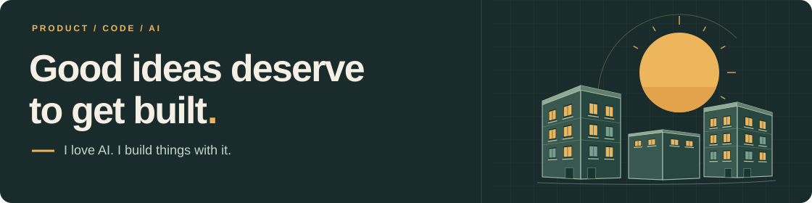

<picture>
  <source media="(max-width: 600px)" srcset="https://raw.githubusercontent.com/TonyRod116/TonyRod116/68e73f3bcb26f5e1f0065a90860fd5c0c2134b0b/assets/banner-mobile.svg">
  
</picture>

# Tony Rodríguez

**Founder of [BuildApp](https://buildapp.es/) · Software engineer · Barcelona**

I build products around things I know and problems I run into: renovating a home, finding a sunny terrace, or keeping an eye on my AI tools. I work across product, full-stack engineering and applied AI, from the first sketch to the shipped app.

**I love AI:** understanding how it works, experimenting with it and turning that curiosity into useful products.

**[Portfolio](https://tony-r.com/)** &nbsp; / &nbsp; **[LinkedIn](https://www.linkedin.com/in/tony-rod/)** &nbsp; / &nbsp; **[Say hello](mailto:tony.rod.bcn@gmail.com)**

## What I’m building

### BuildApp · From a room photo to a renovation proposal

Before software, I ran a renovation business. Now I’m turning that experience into a product for the people on both sides of the work.

**One app, two experiences:**

- **Client:** photograph a room, describe the change and explore an AI visualization with an indicative cost. Keep ideas and photos together for a conversation with a professional.
- **Professional:** turn site photos and a description into an editable, itemized quote. Review quantities, prices and VAT, add a visual proposal, then share by WhatsApp, link or PDF.

Available on **iPhone and Android**, with **Pro also in the browser**. Each account chooses Client or Professional at registration.

  
  &nbsp;
  
   
  Client + Professional · Official store screenshots with illustrative content.

I lead the company and stay hands-on across product, the professional frontend, mobile delivery and integrations, working with our CTO on the backend and AI workflows.

**[Explore BuildApp →](https://buildapp.es/)** · **[Open Pro on the web](https://buildapp.es/pro/)**

### Rato al Sol · “Will that terrace still be sunny at five?”

A small everyday question became a web and iPhone app. Explore **Madrid and Barcelona**, move the time slider, tap a spot and compare its estimated sun and shade through the day. Search nearby outdoor places by time and distance.

Actual web demo · Building-shadow estimates; trees, awnings and clouds can change the light on the ground.

The interesting part under the map: **shared solar geometry**, building-height data and shadow projection. The mobile app uses **React Native and Expo**; the web and mobile share the calculation engine.

**[Find your sun →](https://tony-r.com/rato-al-sol/)** · **[Get it for iPhone](https://apps.apple.com/es/app/rato-al-sol/id6830366652)** · **[Explore the code](https://github.com/TonyRod116/rato-al-sol-portfolio)**

### AI Desk Display · A second life for an old screen

An old tablet or a compatible ESP32 touchscreen becomes an animated display for **Claude and Codex usage**. Tiny cities, coastal drives and arcade scenes, with optional weather and computer stats. The display runs locally; enabled readers fetch usage from the official providers.

  
   
  Isometric City · Preview uses fictional readings.

**[Build your own →](https://github.com/TonyRod116/ai-desk-display)**

<strong>See the city come to life</strong>

Accelerated time and simulated weather. Collapse this section to hide the animation.

## A few more things to explore

- **[Interactive AI lab](https://tony-r.com/ai):** draw a digit and inspect a neural network’s activations and gradients, or try search and logic through games.
- **[TradeLab](https://github.com/TonyRod116/TradingLab):** a backtesting project combining React, Django, PostgreSQL and market-data processing in Python.
- **[BERT attention visualizer](https://github.com/TonyRod116/ai-attention):** explore how attention heads connect tokens in a sentence.

## How I got here

I founded [Total Homes](https://totalhomes.es/) before moving into software. Working with customers, budgets and real buildings still shapes how I make product decisions: understand the problem, make something concrete, test it and keep improving it.

**I work with:** Python · TypeScript / JavaScript · React · React Native / Expo · Capacitor · FastAPI · Node.js · Django · PostgreSQL · AWS S3 · Playwright.

<strong>Education & foundations</strong>

- **General Assembly** · Software Engineering Immersive.
- **Harvard CS50 AI** · Search, logic, uncertainty, machine learning and language.
- **Stanford / DeepLearning.AI** · Machine Learning Specialization.

<strong>En castellano</strong>

Soy Tony, fundador de BuildApp e ingeniero de software en Barcelona. Antes dirigía una empresa de reformas; ahora construyo productos a partir de problemas que conozco de cerca.

**Me encanta la IA:** entender cómo funciona, experimentar con ella y convertir esa curiosidad en cosas útiles.

**BuildApp** ayuda tanto a quien reforma su casa como al profesional que prepara el presupuesto. **Rato al Sol** te permite explorar dónde podría dar el sol en Madrid y Barcelona. Y con **AI Desk Display** he convertido pantallas olvidadas en pequeños escenarios para consultar el uso de mis herramientas de IA.

Puedes probar los proyectos en los enlaces de arriba o [escribirme](mailto:tony.rod.bcn@gmail.com).

---

Have something useful in mind? **[Let’s talk.](mailto:tony.rod.bcn@gmail.com)**
